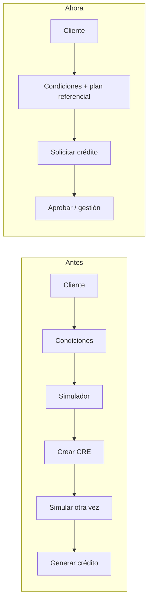
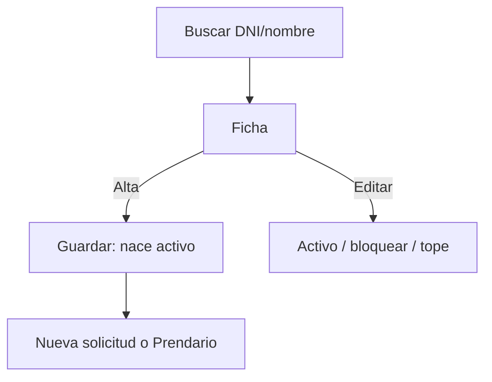
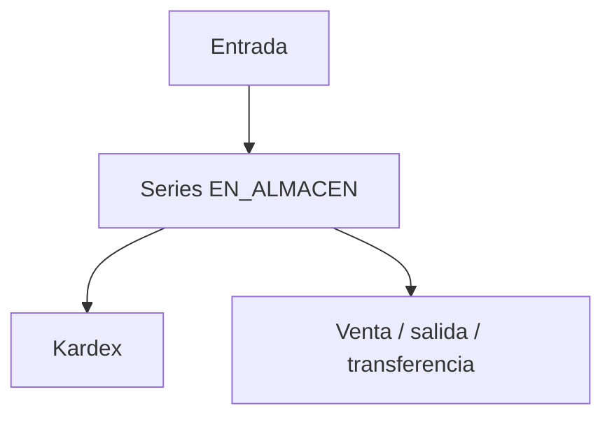
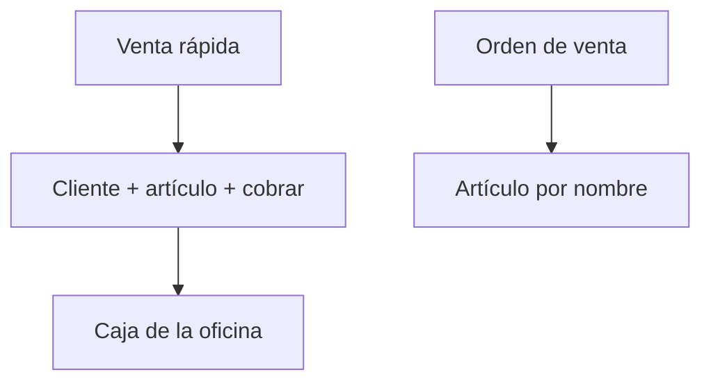
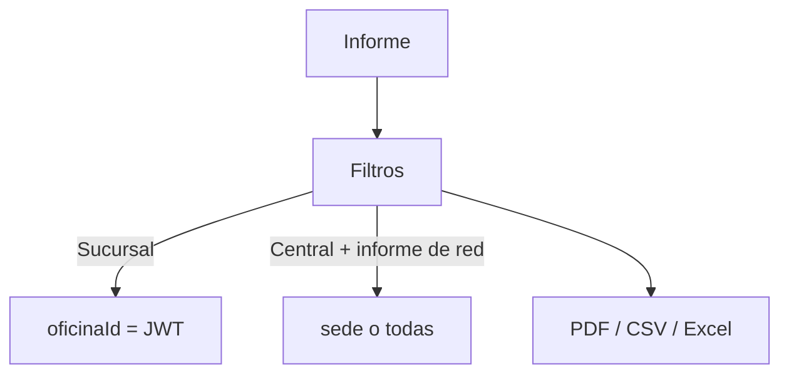
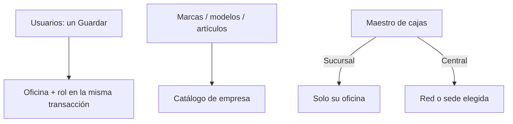

# SSD-18 — Flujos de cada módulo

**Estado:** as-built · 2026-10-26  
**Código:** SPA `/` + API `/api/v1`  
**Complementa:** [SSD-02](SSD-02-credito.md) (originación), [speckit/004](../speckit/004-alcance-red/spec.md) (alcance sucursal vs Central)

Los diagramas describen **lo que hace el sistema hoy**. El motor financiero sigue en `usp_*`; la SPA no calcula cuota, mora ni TEA.

## 1. Originación (cambio 2026-10-26)

El simulador **ya no es un paso** de la solicitud real. Cotiza. La solicitud genera el crédito en la misma pantalla (`usp_Credito_Ins`).



| Camino | Ruta | Motor |
|--------|------|--------|
| Crédito personal | `/credito/nuevo` | `crear-solicitud-credito` + `crear-credito` |
| Prendario | `/credito/prendario/nuevo` | `prendario/crear-solicitud` + bienes + `crear-credito` |
| Cotización | `/credito/simulador` | `usp_SimuladorCredito` (opcional generar) |

## 2. Auth e inicio

```mermaid
flowchart TD
  L[Login] --> JWT[JWT oficina + usuario + roles]
  JWT --> M[Menú vivo por oficina]
  JWT --> H[/inicio]
  H -->|Central IndPrincipal| S[Selector de sede: KPIs de otra oficina]
  H -->|Sucursal| K[KPIs de su JWT]
```

## 3. Clientes



Persona es de **red** (DNI único). El crédito que se origina queda en la **oficina del JWT**.

## 4. Crédito — consulta y ciclo

```mermaid
flowchart TD
  C[/credito/consulta] --> P[Persona]
  P --> G[Elegir crédito]
  G --> PL[Plan usp_EstadoPlanPago]
  G --> AP[Aprobar si PEN/AP1]
  G --> CB[Cobro en caja]
  P --> N[/credito/nuevo]
```

Estados: `CRE` → generar → `PEN`/`AP1`/`APR` → desembolso `DES` → `PAG` / `ANU` / `REP`.

## 5. Aprobar

```mermaid
flowchart TD
  B[/credito/aprobar] --> L[Bandeja de la oficina JWT]
  L -->|CRE| N[Completar en /credito/nuevo]
  L -->|PEN/AP1| A[Aprobar / rechazar usp]
```

## 6. Prendario

```mermaid
flowchart TD
  L[/credito/prendario] --> N[Nuevo]
  N --> S[Solicitar: CRE + bienes + generar]
  S --> G[Gestionar]
  G --> R[Renovar / abonar / liberar / remate]
  L --> W[Avisos WhatsApp 3 días]
```

## 7. Caja

```mermaid
flowchart TD
  D[/caja/diario] --> A[Abrir caja de la oficina]
  A --> C[Cobro / desembolso / anulación]
  C --> Q[Arqueo]
  Q --> Z[Cerrar]
```

Escritura: `ValidateJwtOficina`. No se opera la caja de otra sede.

## 8. Tesorería / bóveda

```mermaid
flowchart TD
  B[/tesoreria/boveda] --> E[Estado de dinero]
  E --> F[Fondear sucursales]
  E --> T[Transferencia / red]
```

Central ve la red. Sucursal ve su bóveda.

## 9. Almacén



Movimientos llevan `oficinaId` del JWT + almacén de esa sede.

## 10. Ventas



## 11. Informes



Los ~28 informes de cartera mandan el JWT oculto: Central entra a la sede o usa cierre gerencial / morosos (spec 004: no se reescriben 40 endpoints). En cierre, gerencia replica el mes anterior y confirma con `usp_GuardarMetaGerencialDefinitiva` (no se inventan cifras).

## 12. Admin y maestros



## 13. Multisucursal — estado

| Área | ¿Cerrado? | Regla |
|------|-----------|--------|
| Login / menú | Sí | Menú y JWT por oficina |
| Escritura crédito / caja / prendario / ventas / almacén | Sí | `ValidateJwtOficina` |
| Clientes (persona) | Sí, por diseño | DNI de red; crédito de oficina |
| Catálogos (marca, artículo, producto) | Sí, por diseño | Empresa, no sede |
| Dashboard `/inicio` | Sí | Central: `sedeId`; sucursal: JWT |
| Cajas maestro | Sí | Sucursal no crea en otra oficina |
| Cobranza / cobro diario / morosidad gestor | Sí | Sucursal = JWT; Central = sede o red |
| Informes de cartera restantes | Sí | Sucursal = JWT (el query ajeno se rechaza). Central entra a la sede o usa cierre/morosos / selector donde ya existe |
| Almacenes (maestro) | Sí | Misma regla que cajas: sucursal solo su sede; Central elige o ve la red |
| Operar caja/crédito de otra sede | No se permite | Hay que entrar a esa oficina |

Cerrado al 100% de la constitución: **sucursal no ve ni escribe lo ajeno**; **Central consolida o elige sede**; **escribir exige JWT = oficina**. Los ~28 informes de cartera no duplican el combo de sede: el token ya es la oficina de trabajo.
